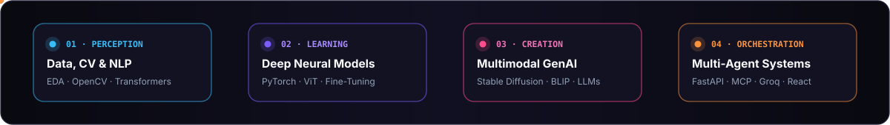

<!-- ===================== PROFILE HEADER ===================== -->

 

 

## 👋 Get to Know Me

Hi, I'm **Mayar** — a Machine Learning Engineer and Information Technology & Computer Science student at **Sinai University**, based in **Cairo, Egypt**.

I love exploring how intelligent systems learn, perceive, and create. Most of my time goes into working with datasets, training neural networks, experimenting with **Computer Vision, NLP, and Multimodal Generative AI**, and designing **multi-agent systems** where AI models collaborate to solve practical problems.

- 🎓 **Studying:** B.Sc. in Information Technology & Computer Science at Sinai University
- 🧠 **What excites me:** Connecting creative AI (like turning human emotions into paintings) with structured engineering (like autonomous agent workflows)
- 🌱 **Currently exploring:** LLM orchestration, Model Context Protocol (MCP), and multimodal pipelines
- 🌐 **Languages:** Arabic (Native) · English (C1)

 

  

<strong>✨ Click to expand: How I approach an AI problem from idea to interactive app</strong>

 

1. **Understand the Data & Signal:** Start with Exploratory Data Analysis (EDA), feature engineering, and visual/text preprocessing (`Pandas`, `NumPy`, `OpenCV`).
2. **Train, Fine-Tune & Evaluate:** Select or adapt the right architecture — classical ML (`Scikit-learn`), deep vision/text models (`PyTorch`, `ViT`, `DistilRoBERTa`), or generative pipelines (`Diffusers`, `LLMs`).
3. **Orchestrate & Connect:** Combine models into cohesive workflows or multi-agent pipelines (`FastAPI`, `MCP`, `Groq`, `AsyncIO`).
4. **Make It Usable:** Wrap the intelligence inside an intuitive interface (`React`, `TypeScript`, `Streamlit`) so anyone can interact with it.

## 🎨 A Peek at What I Enjoy Building

Here are two projects that reflect the two sides of what I love working on — **creative multimodal AI** and **collaborative AI agents**:

### 1. [Emotion-to-Art AI — Painting Emotions in the Style of Van Gogh & the Masters](https://github.com/mayarmajed2/Emotion-Aware-Multi-Artist-Generative-Art-with-Al-Interpretation-on-Gradient1)

An offline multimodal AI application that reads human emotion from text or portrait photos, understands the visual scene, and paints original artwork inspired by **Vincent van Gogh**, **Claude Monet**, and **Leonardo da Vinci** using local Stable Diffusion.

  

 

<table>
  <tr>
    <td width="33%" valign="top">
      
      
<strong>1 · Generation Studio</strong> Mood input &amp; Van Gogh / Masters style selection

    </td>
    <td width="33%" valign="top">
      
      
<strong>2 · Emotion &amp; Canvas</strong> DistilRoBERTa / ViT emotion scores &amp; generated painting

    </td>
    <td width="33%" valign="top">
      
      
<strong>3 · Visual Analytics</strong> OpenCV K-Means palette, saturation heatmap &amp; critique cloud

    </td>
  </tr>
</table>

<strong>🔍 Click to peek under the hood of Emotion-to-Art AI</strong>

 

- **Text Emotion Recognition:** `DistilRoBERTa` (`j-hartmann/emotion-english-distilroberta-base`) classifies text into 7 emotional dimensions.
- **Facial Emotion & Scene Understanding:** Vision Transformer (`ViT`) detects facial emotions while `Salesforce BLIP` captions visual context.
- **Artistic Style Translation & Generation:** Rule-based prompt engineering translates emotion scores into brushwork, lighting, and palette prompts for local `Stable Diffusion v1.5` (Van Gogh impasto swirls, Monet impressionism, Da Vinci sfumato).
- **Computer Vision Analytics:** `OpenCV` + `K-Means` extracts the 5 dominant hex colors, generates saturation heatmaps, outlines facial regions via Haar Cascades, and builds an art critique word cloud.

 

### 2. [SYNAPSE — Multi-Agent AI Software Engineering Workspace](https://github.com/mayarmajed2/SYNAPSE-AI-Platform)

An interactive workspace where **10 specialized AI agents** (from Product Manager and System Architect to Backend, Frontend, QA, Security, and DevOps) collaborate step-by-step to turn an app idea into tested code.

<table>
  <tr>
    <td width="50%" valign="top">
      
      
<strong>Interactive 10-Agent Playground</strong>

    </td>
    <td width="50%" valign="top">
      
      
<strong>Live Command Center &amp; Agent Fleet</strong>

    </td>
  </tr>
</table>

<strong>🧠 Click to see how the 10 AI Agents collaborate in SYNAPSE</strong>

 

- **Live Workspace:** [**synapse-ai-platform-inky.vercel.app**](https://synapse-ai-platform-inky.vercel.app)
- **10 Agent Roles:** Supervisor → Product Manager → System Architect → *(Human Approval Gate)* → Backend Dev → Frontend Dev → Code Reviewer → QA Engineer → Security Agent → Documentation Agent → DevOps Agent.
- **Built With:** `FastAPI`, `React 19`, `TypeScript`, `Groq Llama 3.3 70B`, `SQLAlchemy 2.0`, `PostgreSQL / SQLite`, `WebSockets`, and `Docker`.

## 🛠️ Skills & Technical Toolkit

**Programming Languages**
 

 

  

**Machine Learning, Deep Learning & Computer Vision**
 

 

  

**NLP, Generative AI, LLMs & Multi-Agent Systems**
 

  

**Data Science, Analytics & Visualization**
 

  

**Full-Stack Development, Databases, Cloud & IoT**
 

 

 

 

<table>
  <tr>
    <td width="50%" valign="top">
      <h4>🧠 AI &amp; Data Focus</h4>
      <ul>
        <li><strong>Machine Learning:</strong> Classification, regression, clustering (K-Means), preprocessing, feature engineering &amp; model evaluation</li>
        <li><strong>Deep Learning &amp; Vision:</strong> CNNs, Transfer Learning, Vision Transformers (ViT), OpenCV image analytics &amp; Haar Cascades</li>
        <li><strong>NLP &amp; Multimodal GenAI:</strong> Emotion classification (DistilRoBERTa), scene captioning (BLIP), Stable Diffusion &amp; prompt engineering</li>
        <li><strong>Agentic Systems:</strong> Multi-agent workflows, Model Context Protocol (FastMCP), tool routing &amp; LLM orchestration</li>
      </ul>
    </td>
    <td width="50%" valign="top">
      <h4>💻 Engineering &amp; Delivery</h4>
      <ul>
        <li><strong>Backend &amp; APIs:</strong> FastAPI, Node.js, Express.js, AsyncIO, WebSockets, JWT auth &amp; Swagger/OpenAPI docs</li>
        <li><strong>Frontend &amp; UI:</strong> React 19, Next.js, TypeScript, Vite, Tailwind CSS &amp; interactive Streamlit dashboards</li>
        <li><strong>Databases &amp; Analytics:</strong> PostgreSQL, MongoDB, SQLite, SQLAlchemy ORM, Pandas, Matplotlib &amp; Power BI</li>
        <li><strong>Cloud &amp; Hardware:</strong> Docker, Git/GitHub, Linux, AWS, Azure AI, Vercel, Railway &amp; ESP32/Arduino IoT</li>
      </ul>
    </td>
  </tr>
</table>

## 📊 GitHub Snapshot

## 🤝 Let's Connect

Always happy to chat about **Machine Learning**, **Generative AI**, creative coding, or new ideas.

 

  

